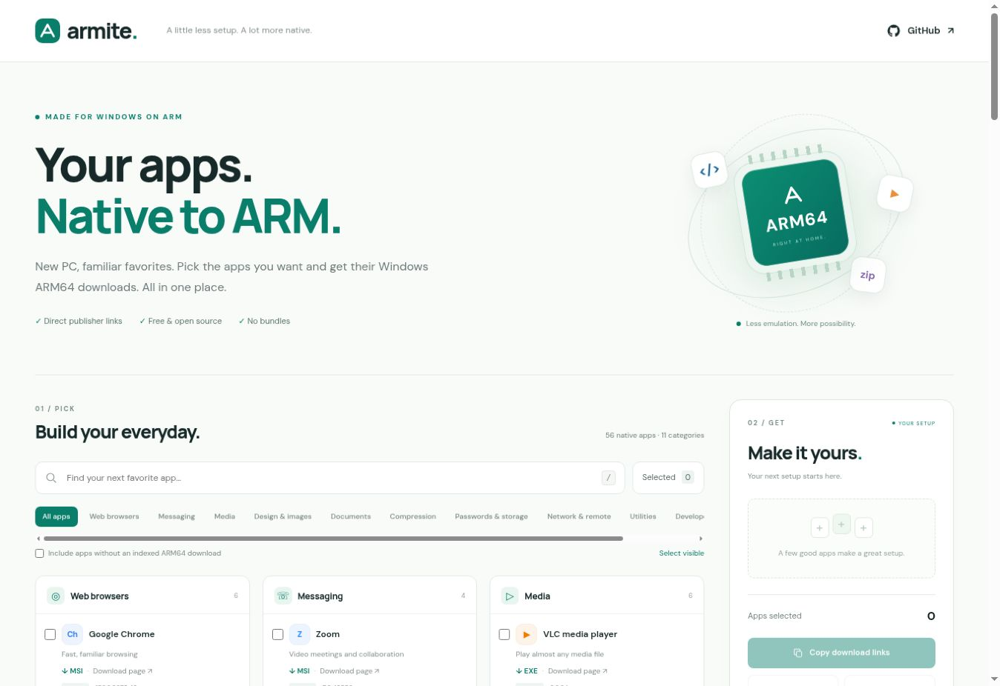

# Armite

**A Ninite-inspired app picker for Windows ARM64.** Select apps, collect direct publisher downloads, and share your setup.

[Website](https://alirezaghm83.github.io/armite/) · [Report a problem or suggest an app](https://github.com/alirezaghm83/armite/issues)



## What you can do

- Browse categorized Windows ARM64 apps, with search and a selected-only filter.
- Pick EXE, MSI, ZIP, MSIX, or bundle variants when available.
- Open each app’s official download page and its architecture evidence.
- Copy every selected direct URL together, one URL per line.
- Copy **one shareable Armite link** that restores selected apps and formats.
- Export plain text or an **aria2 input file**, including published SHA-256 checksums.
- Save selections locally in your browser; use everyday, developer, or home-lab starter packs.
- Use the responsive layout, keyboard controls, and mobile selection shortcut.

Armite is a **link collector**, not a combined installer. It does not install software, host executables, or silently substitute x64 programs. ARM64EC and universal packages that include ARM64 are labeled. No account, backend, runtime API, analytics, or database is required.

## Hosting: GitHub Pages only

The site is entirely static in `docs/`. GitHub Pages should publish **`main` → `/docs`**:

1. Repository **Settings → Pages**.
2. Source: **Deploy from a branch**.
3. Branch: **main**, folder: **/docs**, then Save.

After that, each push to `main` updates the site. The `.nojekyll` file prevents Jekyll processing. All asset and data paths are relative, so the `/armite/` project path works without a domain or another host.

The `Check Armite` GitHub Actions workflow checks JavaScript, catalog invariants, and the resolver on pushes and pull requests. Publishing from the branch uses GitHub’s own Pages build/deploy workflow.

## Run locally

No npm packages or build step are needed. Serve over HTTP (opening `index.html` as `file://` prevents the catalog fetch):

```bash
python3 -m http.server 8000 --directory docs
```

Open <http://localhost:8000>.

```bash
npm run check
python3 -m pip install -r requirements.txt
python3 -m unittest discover -s tests -p '*_test.py'
```

## Update the catalog

`data/sources.json` contains curated application metadata and package IDs. `scripts/refresh_catalog.py` reads Microsoft’s WinGet installer manifests and, for gaps, explicit publisher release information (GIMP, Wireshark, RustDesk, Hiddify). It resolves **Windows** ARM64 artifacts, never Linux/macOS ARM builds.

```bash
python3 -m pip install -r requirements.txt
python3 scripts/refresh_catalog.py
# Or refresh specific apps:
python3 scripts/refresh_catalog.py --only vscode,python,rustdesk
python3 scripts/check_links.py
npm run check
git diff -- docs/data/catalog.json data/
```

Review changes before committing. The catalog is a checked-in snapshot; it is **not refreshed automatically** and does not claim to track the latest releases in real time. Each record has a source URL and checked date. Refresh failures preserve prior records and are reported in `data/refresh-report.json`. An older retained record keeps its original checked date.

The GitHub directory parser depends on GitHub’s public embedded page data. If that markup changes or upstream requests are blocked/rate-limited, the refresher reports errors rather than guessing filenames. Public GitHub API calls used for selected publisher releases can also hit unauthenticated rate limits.

`check_links.py` requests the first 512 bytes and validates EXE/MSI/ZIP container magic. It does **not** download or execute full installers, validate Authenticode signatures, or prove the CPU architecture of embedded payloads. Architecture evidence comes from ARM64-tagged WinGet entries or explicit publisher pages. The checked-in `data/link-check-report.json` records successes and local network failures separately. A locally blocked publisher is not proof of a globally broken download.

Apps with no indexed ARM64 artifact are hidden by default; users may reveal their publisher pages. “Not indexed” does not mean incompatible. Conflicting x64/x86 filenames are withheld even if their manifest says ARM64. For example, the initial Inkscape record needs publisher confirmation. The initial VS Code record also has a package-version/filename discrepancy; the UI follows the actual linked filename version and explains it under Source & details.

## aria2

Select apps → **Export → aria2 input → Save aria2 .txt**, then:

```bash
aria2c -c -x 8 -s 8 -i armite-downloads.txt
```

Published checksums are included when available. Some vendor URLs are evergreen; if the vendor changes a file, an old checksum may fail. Refresh the catalog and export again instead of bypassing integrity checking. Installers may require administrator privileges; MSIX packages may require dependencies, and Docker Desktop requires WSL 2 and supported Windows/virtualization settings. Armite does not manage those prerequisites.

## Structure

```text
docs/                   Static GitHub Pages website
  index.html            Accessible app-picker layout
  styles.css            Responsive visual design
  app.js                Browser interactions
  core.js               Pure selection/filter/export logic
  data/catalog.json     Published download snapshot
  assets/               Local branding and preview image
data/sources.json       App source configuration
data/*report.json       Refresh and network-check reports
scripts/                Catalog maintenance helpers
tests/                  Selection, export, catalog, resolver tests
.github/workflows/      CI validation
```

Selections are encoded as `#apps=chrome,telegram~1`. IDs are resolved against the local catalog; the URL cannot supply arbitrary executable links. Non-default formats use a catalog index. Catalog updates that change the available variants may change or invalidate an old format index; app IDs remain stable.

Inspired by [Ninite](https://ninite.com/), with independent branding and implementation. Not affiliated with Ninite, Microsoft, or any application publisher. Application names belong to their respective owners. Armite’s small app badges are typographic identifiers, not copied vendor logos.

## Initial verification

- Eight Node tests and three Python resolver tests passed.
- Visible desktop and 390 px phone-width browser checks covered selection, variant export, share URLs, reload persistence, search, and the mobile setup shortcut.
- 72 of 73 linked artifact headers matched the expected file type. WireGuard’s download host returned a `Site Unavailable` HTML page in this environment; its ARM64 MSI URL remains source-attributed to the official WinGet manifest.
- The site’s variable fonts are self-hosted; their individual SIL Open Font Licenses are in `docs/assets/fonts/`.
